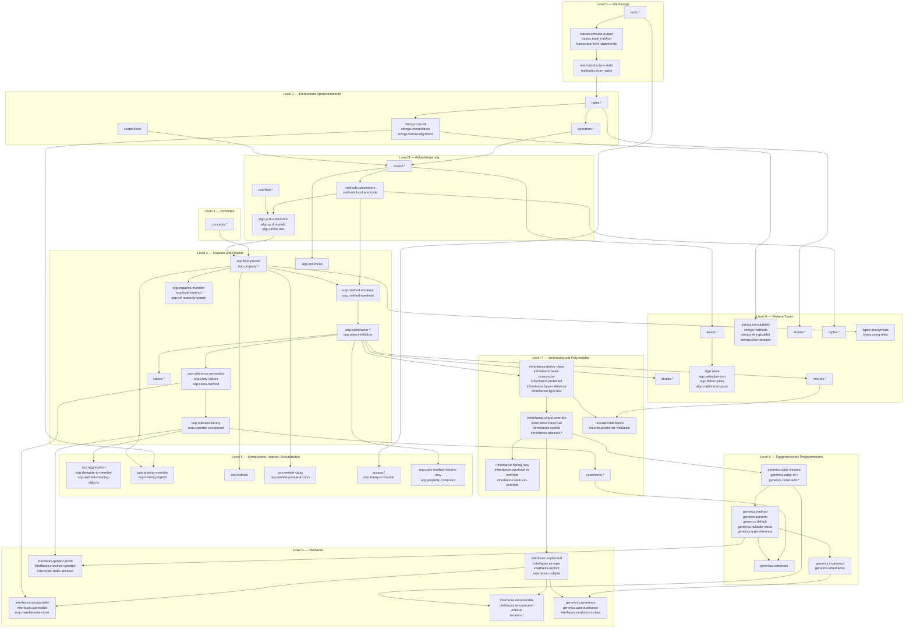
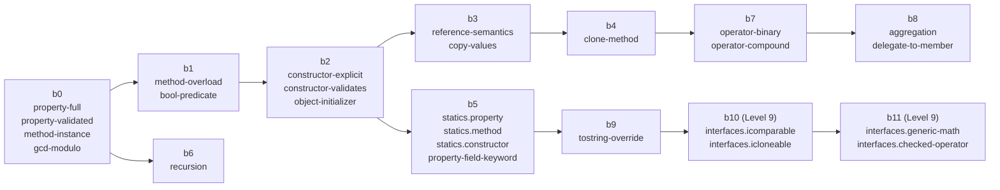

# Skill vocabulary — levels 0–9

Draft from task 3a. `skills.yaml` is the single source of truth; this file
explains it for review. Ids are permanent once a trainee database references
them, so review the ids more carefully than the labels.

## Counts per level (drafting order)

| Level | Topic | Skills | Categories |
|---|---|---:|---|
| 0 | Werkzeuge und erstes Projekt | 14 | tools, basics, methods |
| 1 | Konzepte | 12 | concepts |
| 2 | Elementare Sprachelemente | 31 | types, scope, strings, operators |
| 3 | Ablaufsteuerung | 22 | control, overflow, methods, algo |
| 4 | Klassen und Objekte | 29 | oop, statics, algo |
| 5 | Komposition, Indexer, Schutzstufen | 13 | oop, access |
| 6 | Weitere Typen | 29 | structs, arrays, algo, strings, enums, tuples, records, types |
| 7 | Vererbung und Polymorphie | 20 | inheritance, extensions, records |
| 8 | Typgenerisches Programmieren | 13 | generics, algo |
| 9 | Interfaces | 21 | interfaces, iterators, generics, oop |

206 skills (150 from the levels 0–6 draft, `oop.indexer-overload` and
`algo.vector-geometry` added for level 5, 54 for levels 7–9). Level 2 and 6
are above the 25 guideline because they each cover five to eight book
sections; split the levels rather than coarsening the skills if that bothers
you.

A skill's level is **not** stored in `skills.yaml`. It is derived from the
exercises that teach it, so the table above only reflects the drafting order.

## `Klassen und Objekte/Bruch/b0`–`b9` → `teaches`

What the trainee would have to write if the sample became an exercise (the
sample is the model answer, the starter is the sample with those parts
removed). `requires` lists what the exercise builds on; entries in *italics*
come from levels 0–3 and only become valid once those levels are authored.

| Sample | Exercise | `teaches` | `requires` |
|---|---|---|---|
| b0 | 4.1 Felder, Eigenschaften, Validierung | `oop.field-private`, `oop.property-full`, `oop.property-validated`, `oop.property-backing-field`, `oop.method-instance`, `algo.gcd-modulo` | *types.int, control.if-else, control.do-while, operators.integer-division, methods.parameters* |
| b1 Methoden-Überladung | 4.2 | `oop.method-overload`, `methods.bool-predicate` | `oop.method-instance`, `oop.property-validated` |
| b2 Konstruktoren | 4.3 | `oop.constructor-explicit`, `oop.constructor-default`, `oop.constructor-validates`, `oop.object-initializer` | `oop.property-validated`, `oop.method-overload`, `algo.gcd-modulo` |
| b3 DuplWerte | 4.4 | `oop.reference-semantics`, `oop.copy-values` | `oop.constructor-explicit`, `oop.method-instance` |
| b4 Klone | 4.5 | `oop.clone-method` | `oop.copy-values`, `oop.constructor-explicit` |
| b5 Statische Member | 4.6 | `statics.property`, `statics.method`, `statics.constructor`, `oop.property-auto`, `oop.property-field-keyword` | `oop.constructor-explicit`, `oop.property-validated` |
| b6 Rekursion | 4.7 | `algo.recursion` | `algo.gcd-modulo`, *control.if-else* |
| b7 Operatoren-Überladung | 4.8 | `oop.operator-binary`, `oop.operator-compound` | `oop.clone-method`, `oop.method-instance`, *strings.interpolation* |
| b8 Aggregation | 5.1 | `oop.aggregation`, `oop.delegate-to-member`, `oop.method-chaining-objects` | `oop.operator-binary`, `oop.constructor-explicit` |
| b9 ToString-Überschreibung | 5.2 | `oop.tostring-override`, `oop.tostring-implicit` | `oop.property-auto`, *strings.interpolation* |

b10 and b11 (interfaces, generic math) live in level 9 and give `applied`
credit for the level 4–5 skills.

**Current state in `modules/`.** Levels 0–9 are authored. Levels 0–3 and the
level-4 Bruch chain b0, b1, b2, b5, b6, b7 (exercises 4.1, 4.2, 4.3, 4.6,
4.7, 4.8 plus the 4.0 terminology quiz) came first; b3/b4 (4.4, 4.5) are not
written, so the b7 starter still stubs `DuplWerte` and `Klone` and teaches
`oop.clone-method` and `oop.copy-values` itself. 4.7 (b6) exposes the
recursive ggT as a public static method and adds factorial and Fibonacci
(`algo.factorial`, `algo.fibonacci`). Level 2 teaches its
`types.*`/`operators.*` vocabulary across three coding exercises and two
quizzes; the `operators.*` quiz carries six skills.

Levels 5–9 follow the exercise plan in the tool repo's `MODULE-MAP.md`:

| Level | Exercises | Notes |
|---|---|---|
| 5 | 01 Aggregation (b8), 02 ToString (b9), 03 Indexer, 04 Geschachtelte Klassen, 05 R2Vek, 06 Bibliothek und Konsument (FractionLib) | 5.6 is the first two-project starter (library + console); its test project references both. |
| 6 | 01 Strukturen und Boxing, 02 Sieb, 03 Matrix, 04 Lotto, 05 Zeichenfolgen, 06 Enums und Tupel, 07 Records und anonyme Typen | 6.1/6.2 and 6.9/6.10 of the map were merged; `control.nested-loops` is taught by the sieve. |
| 7 | 01 Figurenhierarchie, 02 virtual/override, 03 Abstrakte Klassen, 04 Reparatur (7.16/1–2), 05 Ausblenden-Quiz, 06 Erweiterungsmitglieder, 07 Record-Figuren | The 04 starter does not compile by design (fix-the-error exercise). |
| 8 | 01 Generischer Stapel, 02 Sortierte Liste, 03 default und Nullable, 04 Generische Erweiterungen, 05 Max mit Serienparameter, 06 Generics-Quiz | `Listenwerte` (8.8/2) appears only as a quiz item. |
| 9 | 01 Interface implementieren, 02 Explizite Implementation, 03 Bruch IComparable/ICloneable (b10), 04 Enumeratoren (hand-written), 05 Iteratoren (yield), 06 Generische Mathematik (b11), 07 Interfaces-Quiz | b10/b11 give applied credit for the level 4–5 Bruch skills; `overflow.checked` is taught by 9.6 because level 3.6 was never authored. |

Skills in the vocabulary that no exercise teaches yet (left for the missing
exercises 0.2, 3.6, 4.4, 4.5, 4.9): `oop.reference-semantics`,
`oop.local-method`, `oop.required-member`, `oop.ref-readonly-param`,
`overflow.wraparound`, `overflow.min-max-value`, `types.long`, `types.float`,
`types.bit-pattern`, `strings.escape` and a few `tools.*` ids from level 0.
Requiring one of them is a validation error, so manifests avoid them.

## Skill graph, levels 0–9

Nodes are skill groups (one per category and level); edges are the
dependencies the exercises above and the module map imply. The full
per-skill graph is what `seesharp validate` checks; drawing all 148 nodes is
not readable.

### Bruch chain in detail (levels 4–5)

